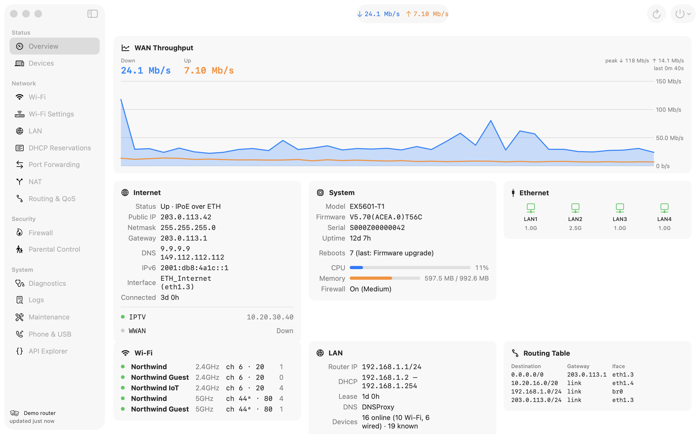
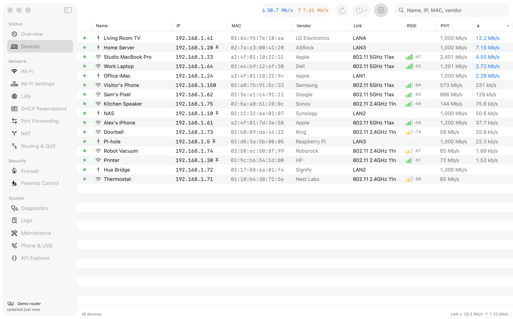
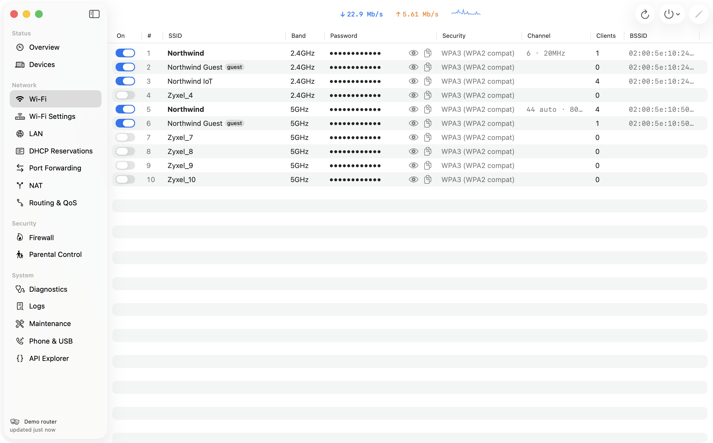
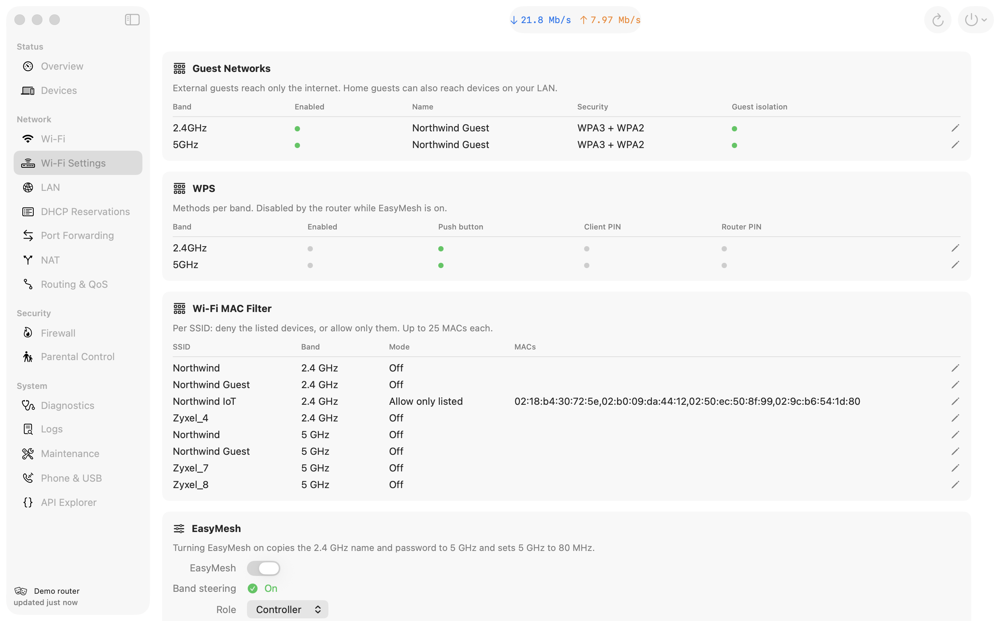
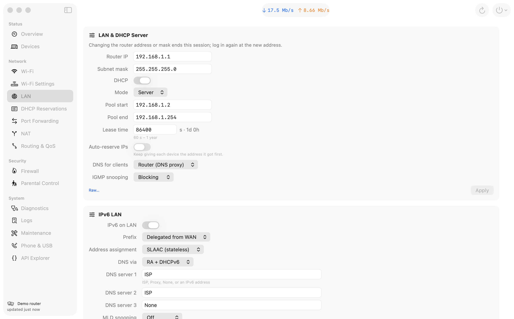
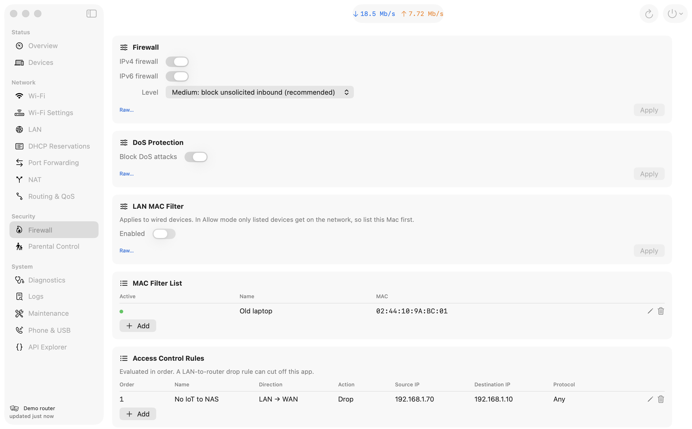
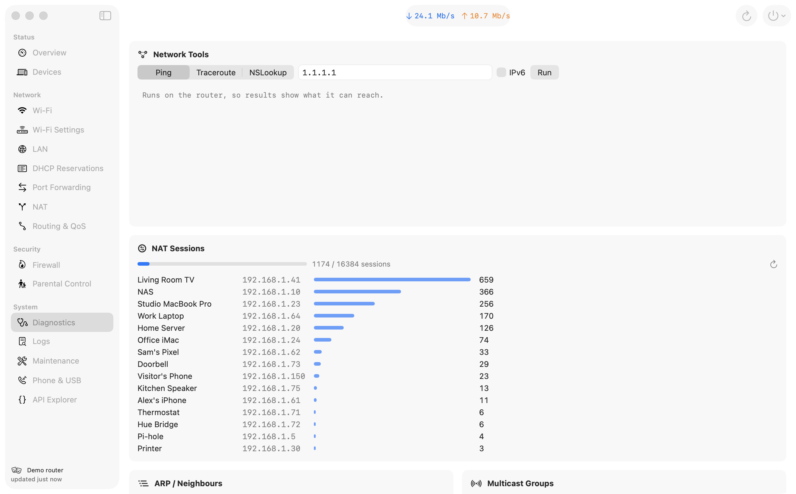
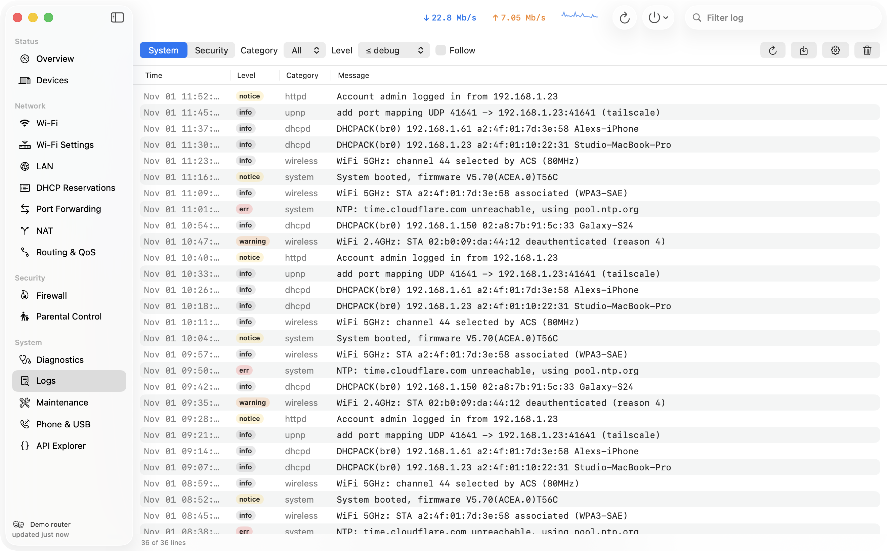
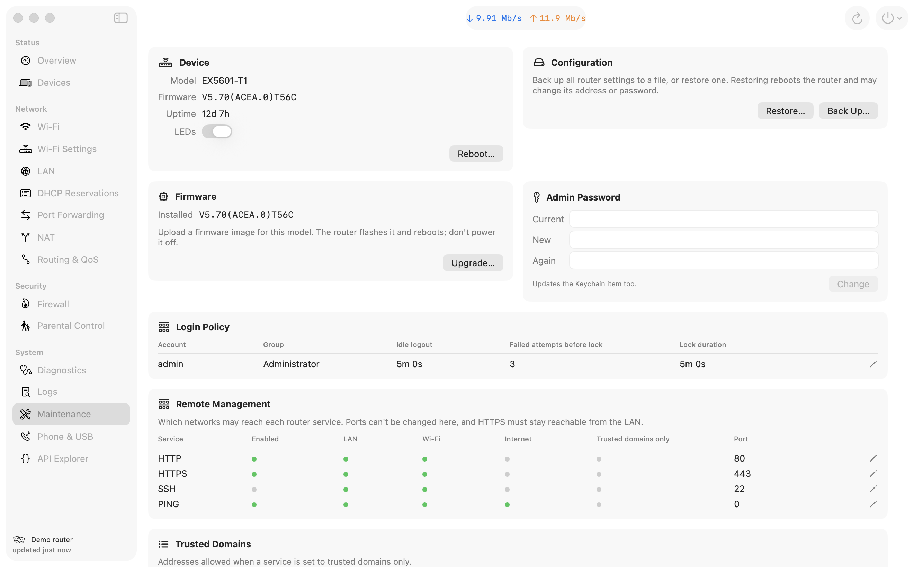

# Fyxel

A native macOS admin app for Zyxel "OPAL" routers, replacing the stock web UI with
something dense, fast and keyboard-friendly. Built against an **EX5601-T1** (firmware
`V5.70(ACEA.0)T56C`); other OPAL-based Zyxel models will probably mostly work.



> Screenshots come from the built-in demo router (`make demo`). Every device, address and
> name in them is made up.

## What it does

| | |
|---|---|
| **Overview** | Live WAN throughput graph, public IP / gateway / DNS, CPU and memory, Ethernet link speeds, Wi-Fi radios, DHCP pool, routing table |
| **Devices** | Every LAN host with live per-device ↓/↑ rate, RSSI, PHY rate, vendor, uptime. Rename, reserve IP, block internet, Wake-on-LAN, raw JSON |
| **Wi-Fi** | All SSIDs: on/off, reveal/copy passwords, edit name, password, security mode (WPA2 / WPA3 / transition / OWE / open), hidden, channel, bandwidth |
| **Wi-Fi Settings** | Guest networks (isolation, own subnet, rate limits), WPS, per-SSID MAC allow/deny lists, EasyMesh, radio power / beacon / DTIM / RTS, schedules |
| **LAN** | Router IP and mask, DHCP server / relay, pool, lease, client DNS mode, IGMP snooping, IPv6 LAN (prefix, SLAAC/DHCPv6, DNS), local DNS names, UPnP, Dynamic DNS, additional subnets |
| **DHCP Reservations** | Static leases, with each device's online state and current IP |
| **Port Forwarding** | Add / edit / duplicate / delete rules; UPnP and NAT-PMP mappings created by devices |
| **NAT** | DMZ, ALGs, per-device session limit, port triggering, address mapping |
| **Routing & QoS** | Static, policy and DNS routes; QoS, queues, shapers |
| **Firewall** | Level, IPv4/IPv6, DoS protection, wired MAC filter, access-control rules, service definitions |
| **Parental Control** | Profiles with devices and blocked time ranges; blocked and always-allowed sites |
| **Diagnostics** | Ping, traceroute and nslookup run *from the router*; NAT session usage per device; ARP/neighbour table; multicast groups |
| **Logs** | System and security logs with category, level and text filters, follow mode, export, clear, and log settings |
| **Maintenance** | Reboot, LEDs, config backup and restore, firmware upgrade, admin password, login policy, remote-management access, trusted domains, time/NTP |
| **Phone & USB** | Phone ports, caller-ID region, SIP accounts, USB file shares, DLNA media server, cellular backup |
| **API Explorer** | GET any `/cgi-bin/…` endpoint and see the decrypted JSON |

`⌘K` (or `⇧⌘P`, or the "Go to…" field at the top of the sidebar) opens a fuzzy finder over every
page, panel, setting and action, plus your Wi-Fi networks, devices, reservations and port forwards,
and any value on a settings page you've opened this session (local DNS names, DDNS host…). Pick
one and the app goes there: it scrolls to and highlights the setting, or opens the editor for
the network, rule or reservation.

`⌘1`–`⌘9` jump between the first nine sections, `⌘R` refreshes, `⌘N` adds a rule or
reservation, `⌫` deletes, and double-clicking a row opens it. Writes that can disconnect
you (radio restarts, LAN address changes, firewall and remote-management rules) ask first,
and the app refuses edits that would obviously lock it out, such as removing LAN access to
HTTPS.

| | |
|---|---|
|  |  |
|  |  |
|  |  |
|  |  |

### Account levels

Zyxel routers have several account levels. The `admin` account an ISP gives you is often
"medium", and the router refuses some objects to it outright (`ZCFG_REQUEST_REJECT`):
on the EX5601-T1 that includes WAN, QoS, static/policy/DNS routes, time/NTP and SIP. Those
pages show a lock notice instead of failing, and work as-is with a "high" account.

## Install

Download the DMG from [Releases](https://github.com/rossng/fyxel/releases), open it and drag
Fyxel into Applications. It needs macOS 14+ on Apple silicon. The build isn't notarized, so the
first time you open it macOS refuses: go to System Settings › Privacy & Security and click
**Open Anyway**, or run `xattr -dr com.apple.quarantine /Applications/Fyxel.app`.

### From source

Needs macOS 14+ and Xcode or the Command Line Tools (`xcode-select --install`).

```sh
git clone <this repo> fyxel && cd fyxel
make install      # -> /Applications/Fyxel.app and ~/.local/bin/fyxelctl
make demo         # or try it first against the simulated router
```

The Makefile signs with your "Apple Development" identity if you have one, and ad-hoc
otherwise. To install on a Mac without the toolchain, run `make zip` and copy
`build/Fyxel.zip` across. If it was downloaded or AirDropped, run
`xattr -dr com.apple.quarantine /Applications/Fyxel.app` before opening it, because the build
isn't notarized. `make dmg` builds the release disk image (ad-hoc signed; needs
[uv](https://docs.astral.sh/uv/) for dmgbuild).

On first launch macOS asks for **Local Network** access. Allow it, or the app can't reach
the router.

## Login and Keychain

Log in once with "Save in Keychain, unlock with Touch ID" ticked. After that, launching the app
asks for Touch ID (or your Mac password) and logs in.

- The password is stored as a generic password item (service `eu.rossng.fyxel.router`, account
  `user@host`) in your login keychain. Each Mac keeps its own copy.
- Touch ID is enforced by the app, which runs `LAContext` before reading the item. The Keychain
  ACL itself isn't bound to biometrics, because hardware-bound items need a provisioning profile.
- Builds signed with an Apple Development identity keep Keychain access across rebuilds. Ad-hoc
  builds may show a one-time "allow access" Keychain prompt after each rebuild.
- Changing the admin password in Maintenance also updates the Keychain item.

While the app is running it keeps the session alive by polling. It logs in again by itself if
the router expires the session, or once the router is back after a reboot, restore or firmware
upgrade started from the app. Quitting the app logs out.

The router uses a self-signed certificate. Fyxel trusts the first certificate it sees for the
host and then pins it (Settings, `⌘,`). If the certificate changes, for example after a factory
reset, you get a "Trust New Certificate" button.

## fyxelctl

```sh
fyxelctl dal lanhosts                        # GET /cgi-bin/DAL?oid=lanhosts → Object
fyxelctl get /cgi-bin/RoutingTable_handle
fyxelctl put nat_conf '{"DMZHost":"0.0.0.0"}' # PUT a DAL object
fyxelctl delete static_dhcp 3                # DELETE ?Index=3
fyxelctl selftest                            # add + edit + delete a throwaway rule and lease
fyxelctl selftest-specs                      # same for a DNS name, port trigger and firewall service; toggle LEDs
fyxelctl specs                               # load every settings page; shows which ones your account may use
fyxelctl ping 1.1.1.1                        # ping from the router
eval "$(fyxelctl login)"                     # export a session so later calls skip login
FYXEL_MOCK=1 fyxelctl dal wlan               # same commands against the mock router
```

`fyxelctl` takes its password from the Fyxel keychain item and asks for Touch ID. The first time
it runs, macOS asks whether `fyxelctl` may read the item; choose "Always Allow". You can also
set `FYXEL_PASSWORD`, `FYXEL_HOST` and `FYXEL_USER`.

The router rotates its CSRF token during a session. When you reuse an exported session, set
`FYXEL_SESSION_FILE=path` and `source` that file before each call, so the rotated token carries
over. Otherwise writes start failing with an empty HTTP 403. The app handles this itself by
logging in again.

## Architecture

```
Sources/
  FyxelCore/      no UI. Everything that knows about the router.
    RouterAPI.swift      the protocol the rest of the app is written against
    RouterClient.swift   real implementation: HTTPS, AES/RSA envelope, CSRF, re-login, cert pinning
    Crypto.swift, Credentials.swift (Keychain + Touch ID)
    Models.swift         typed views over status / hosts / traffic
    Operations.swift     typed writes (port forwards, reservations, Wi-Fi, hosts, WOL)
    Diagnostics.swift, Maintenance.swift
    DALSpec.swift        declarative descriptions of config objects + generic load/save/delete
    Specs/               one file per area: fields, enums, and the payload quirks of each object
  FyxelMock/      MockRouter: an in-memory router with fictional data
  Fyxel/          the SwiftUI app; talks only to `any RouterAPI`
  fyxelctl/       command-line client
Tests/            swift-testing suites, run against MockRouter
```

**The UI never sees the transport.** `AppModel` holds an `any RouterAPI`. `RouterClient`
implements it for real hardware, and `MockRouter` implements it in memory. `MockRouter` emulates
the DAL's add/edit/delete semantics, moves traffic counters, uptime and CPU over time, and
answers the diagnostic, log and LED endpoints. Every operation, spec and screen therefore works
unchanged against either. Use it for:

- the demo: the "Explore with demo data" link on the login screen, `make demo` or `FYXEL_MOCK=1`.
- unit tests: `make test`.
- screenshots: `make screenshots` regenerates `docs/screenshots/`.

Most settings pages are data, not code. Each `ObjectSpec` lists fields (type, label, enum
choices, visibility conditions, validation) plus the object's quirks:
- a `transform` from the GET shape to the PUT shape;
- extra write query parameters;
- `DELETE` keyed by `idx` instead of `Index`;
- a follow-up call such as `Wireless?action=WlCheck`;
- an async `prepare` hook for objects that must be written as a whole array.

`SpecPage` renders them as inline forms (single objects) or compact tables with add / edit /
delete sheets (lists). Anything a spec doesn't describe is still visible via "Raw…".

## API notes

The stock UI is a Vue app. Every `/cgi-bin/` request and response is wrapped like this:

- Login: `GET /getRSAPublickKey` returns a PEM key. The client then picks a random 32-byte AES
  key and sends `POST /UserLogin` with the body `{content, key, iv}`:
  - `content` = AES-256-CBC/PKCS7 of the JSON `{Input_Account, Input_Passwd: base64(pw), …}`
  - `key` = RSA-PKCS1(base64(aesKey))
  - `iv` = 32 random bytes; only the first 16 are used
- The response is encrypted the same way. It contains `sessionkey`, which is the CSRF token, and
  it sets the `Session` cookie.
- Requests after login:
  - GET responses are `{content, iv}` encrypted with the same AES key. A GET with
    `DalGetOneObject=y&Index=N` returns one record.
  - POST and PUT bodies are `{content, key: "", iv}`. An empty body is sent unencrypted.
  - DELETE puts its parameters in the query string.
  - Every write sends a `CSRFToken` header.
  - An expired session answers `{"result":"Invalid Username or Password"}` or HTTP 504
    `{"result":"Timeout"}`.
- Objects live at `/cgi-bin/DAL?oid=<name>`. Most lists are POST to add, PUT the whole record to
  edit and `DELETE ?Index=N` to remove, but many objects differ:
  - read and write field names can differ (`firewall` writes `Firewall_Enable`; `nat_trigger`
    reads `TriggerPort` and writes `TriggerPortStart`);
  - `mgmt_srv` and `macfilter` are written as one array;
  - Wi-Fi writes are followed by `GET /cgi-bin/Wireless?action=WlCheck`;
  - the GUI labels for the firewall level are shifted against the stored values.

  `Sources/FyxelCore/Specs/` records all of these.
- File uploads (firmware: field `filename` to `/cgi-bin/Firmware_Upgrade`; config restore:
  field `mtenRestoreCfg` to `/cgi-bin/Backup_Restore?action=Restore`) are plain multipart
  posts with the CSRF header. Config backup is a plain GET of
  `/cgi-bin/Backup_Restore?action=Backup`.

## Development

```sh
make demo                         # app against MockRouter
make test                         # unit tests (works with just the Command Line Tools)
make screenshots                  # regenerate docs/screenshots from the mock
swift build && .build/debug/Fyxel
```

- `FYXEL_MOCK=1` (optionally with `FYXEL_MOCK_LEVEL=medium` to see the permission notices)
  runs against the mock.
- `FYXEL_SESSION`, `FYXEL_AESKEY` and `FYXEL_CSRF` (the browser's `Session` cookie,
  `localStorage.AesKey` and `localStorage.zySessionKey`) let the app and `fyxelctl` reuse an
  existing browser session. The app never logs out a borrowed session.
- `FYXEL_SNAPSHOT_DIR=/some/dir` makes the app write a PNG of each section and quit. Pick
  sections with `FYXEL_SNAPSHOT_ONLY=Overview,Logs`.

Not implemented on purpose: factory reset, and anything that needs the ISP's supervisor account.
